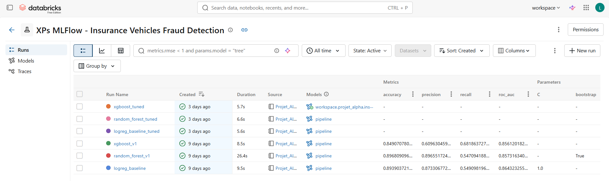
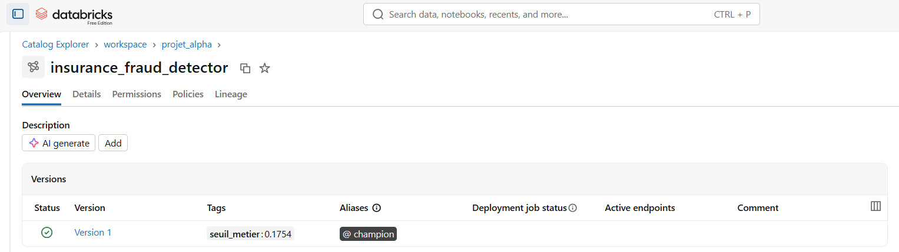
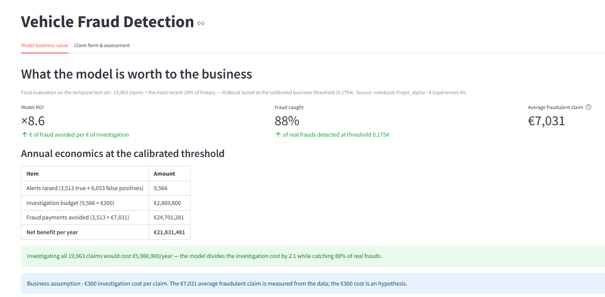
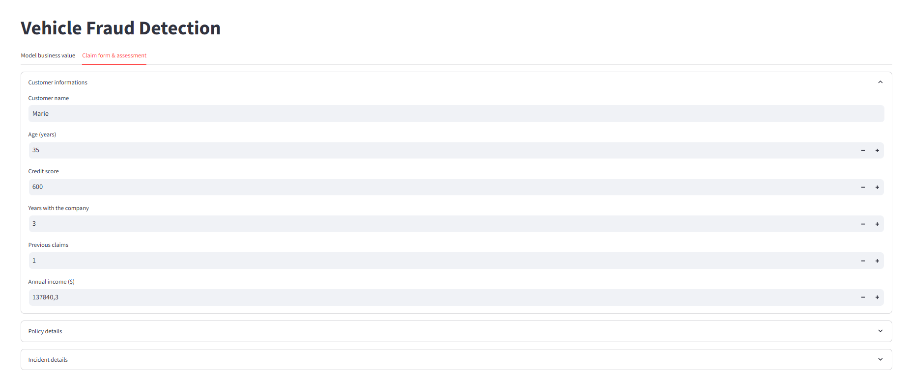
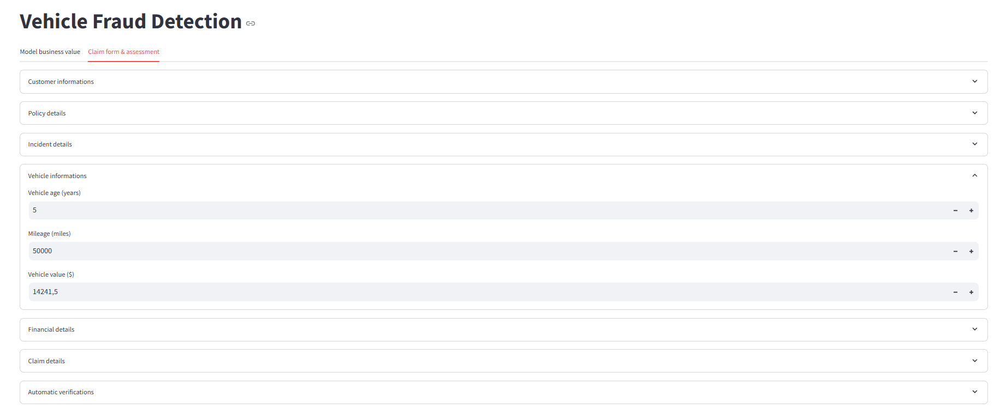
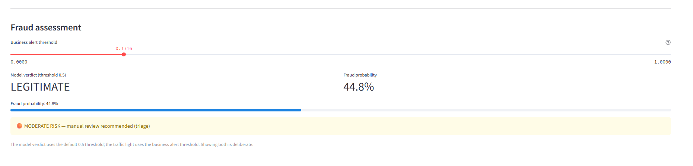

# Projet - Détection de fraude sur sinistres automobiles

**Pipeline complet de Machine Learning orienté métier** : du nettoyage des données brutes au modèle déployé dans le Model Registry, avec un seuil de décision calibré sur un objectif business (rappel ≥ 90 %) et une justification économique chiffrée du point de fonctionnement.

> *Projet de fin de formation — Databricks, MLflow, scikit-learn, XGBoost. Chaque choix méthodologique est documenté dans les analyses du notebook.*

---

## 1. Le problème métier

Une compagnie d'assurance reçoit 100 000 déclarations de sinistres par an, dont **~20 % sont frauduleuses**. L'équipe anti-fraude ne peut pas tout investiguer : chaque alerte déclenchée coûte une investigation (300 €), chaque fraude non détectée coûte un versement induit (~7 000 € en moyenne).

La question est donc :

> **Quel volume d'alertes une équipe d'investigation peut-elle absorber, pour attraper un maximum de fraudes ?**

L'objectif métier fixé  : **détecter au moins 90 % des fraudes** en minimisant le nombre d'alertes — soit maximiser la **précision à rappel contraint**.

---

## 2. Dataset — Insurance Claim Fraud Detection (100k)

Dataset **synthétique** de 100 000 sinistres d'assurance automobile, conçu pour la classification ML, la détection d'anomalies, l'analyse de risque financier.. Il modélise des relations réalistes entre profils clients, polices, détails de l'incident, comportement de déclaration, informations financières et indicateurs de fraude via un moteur de risque pondéré non linéaire.

### Spécifications

- **Source :** Kaggle
- **Lignes :** 100 000
- **Colonnes :** 62 (61 features + 1 cible binaire)
- **Cible :** `fraudulent` (fraude : 20,04 % / non fraude : 79,96 %) — renommée `is_fraud` dans la table Gold
- **Valeurs manquantes :** 0 · **Lignes dupliquées :** 0 · **Clé unique :** `claim_id`

### Colonnes par catégorie

| Catégorie | Colonnes |
|---|---|
| Claim Information | `claim_id`, `policy_id`, `customer_id`, `claim_date`, `incident_date`, `claim_status`, `claim_amount`, `approved_amount`, `deductible`, `claim_duration_days` |
| Customer Information | `customer_name`, `age`, `gender`, `marital_status`, `occupation`, `annual_income`, `education_level`, `credit_score`, `years_with_company`, `previous_claims` |
| Policy Details | `policy_type`, `policy_start_date`, `policy_duration_years`, `premium_amount`, `coverage_amount`, `deductible_plan`, `payment_method`, `policy_active` |
| Incident Details | `incident_type`, `accident_severity`, `incident_location`, `weather_condition`, `police_report`, `witnesses`, `injuries`, `hospital_visit`, `property_damage`, `vehicle_damage` |
| Vehicle Details | `vehicle_make`, `vehicle_model`, `vehicle_year`, `vehicle_age`, `mileage`, `vehicle_value`, `ownership_type` |
| Fraud Indicators | `suspicious_documents`, `claim_submitted_at_night`, `multiple_claims_last_year`, `delayed_reporting`, `inconsistent_statements`, `gps_location_match`, `repair_shop_verified`, `identity_verified`, `claim_history_risk`, `fraud_risk_score` |
| Financial Information | `repair_cost`, `medical_cost`, `towing_cost`, `rental_vehicle_cost`, `total_loss`, `payout_amount` |
| Cible | `fraudulent` (Yes / No) |

### Génération de la cible

La cible `fraudulent` n'est pas tirée aléatoirement : elle est générée par un **système de scoring de risque multi-facteurs**. Principaux facteurs :

- documents suspects et échecs de vérification d'identité ;
- incohérences de localisation GPS ;
- déclarations contradictoires ;
- signalement retardé de l'incident ;
- accidents graves sans rapport de police ;
- multiples sinistres antérieurs ;
- montants de réclamation élevés ;
- établissements de réparation non vérifiés ;
- bruit gaussien ajouté pour des frontières de décision réalistes.

Ce lien direct entre indicateurs de fraude et cible explique pourquoi les modèles s'appuient massivement sur les flags métier (voir l'analyse de feature importance du Notebook 4).

---

## 3. Architecture du projet

```
Volume de données brutes (CSV) — /Volumes/workspace/default/projet_alpha/
   │  arrivée d'un nouveau fichier → job Lakeflow Projet_Alpha - Pipeline ETL Quotidien
   ▼
Notebook 1 — Ingestion (Bronze) : tâche bronze_ingestion (Auto Loader incrémental)
   ▼
Bronze (données brutes versionnées)
   │  tâche silver_clean (dépend de bronze_ingestion)
   ▼
Notebook 2 — Nettoyage (Silver)
   ▼
Silver (typage, doublons, valeurs impossibles)
   │  Notebook 3 — Features + contrôles qualité (exécution manuelle)
   ▼
Gold : workspace.projet_alpha.insurance_claim_fraud_gold
   │  Notebook 4 — Expérimentation ML complète (exécution manuelle)
   ▼
MLflow (6 runs tracés) ──► Model Registry (Unity Catalog)
   │                        alias champion + seuil métier en tag
   ▼
Application Streamlit (Databricks Apps — dossier Streamlit_App/)
```

| Livrable | Contenu |
| --- | --- |
| Notebooks 1–3 | Pipeline Bronze → Silver → Gold, contrôles qualité à chaque étape |
| Notebook 4 | Split temporel, 3 familles de modèles, optimisation du seuil, tuning, analyse économique, MLflow + Registry |
| Table Gold | 100 000 sinistres, 29 features (montants, historique, flags métier, ratios) |
| Registry | `workspace.projet_alpha.insurance_fraud_detector` — version 1, alias **champion** |
| Job Lakeflow | `Projet_Alpha - Pipeline ETL Quotidien` — déclenche les notebooks 1 → 2 à l'arrivée d'un nouveau fichier dans le volume (voir section 11) |

**Feature engineering** (Notebook 3) : ratios métier (`repair_cost_ratio`, `claim_amount_ratio`), flags de comportement (`is_delayed_reported`, `is_night_claim`, `has_police_report`), interactions (`severe_no_police_report` = gravité élevée sans rapport de police).

---

## 4. Méthodologie — les choix qui comptent

### 1. Split temporel, pas aléatoire
Le train/test est fait **par date de sinistre** (`PERCENT_RANK` sur `claim_date`, 80/20) : le test est toujours **postérieur** au train. Un split aléatoire aurait laissé le modèle voir le futur — data drift.

### 2. Validation croisée temporelle
Le tuning utilise `TimeSeriesSplit` (3 folds) : chaque fold valide sur un futur chronologique du train.

### 3. Le seuil de décision n'est pas un hyperparamètre
Le seuil métier est :

1. **exclu du GridSearch** (il ne fait pas partie de l'apprentissage) ;
2. **calibré sur la validation** (dernier fold chronologique, via un modèle jumeau re-entraîné par `clone()` sur le passé du fold) ;
3. **évalué une seule fois sur le test** — jamais ajusté dessus.

Résultat : une mesure honnête. Le rappel observé sur le test (0,88–0,89) tombe légèrement sous la cible 0,90 calibrée en validation — c'est **l'écart de généralisation réel**.

### 4. Scoring indépendant du seuil
Le RandomizedSearch optimise l'`average_precision` (aire sous la courbe Précision-Rappel) : qualité du tri des sinistres, sans dépendre d'un seuil arbitraire.

### 5. Le pipeline ML est un objet
`StandardScaler` (numériques) + `OneHotEncoder` (gravité) + flags → classifieur, le tout dans un `Pipeline` sklearn, journalisé tel quel : pas de divergence possible entre le prétraitement à l'entraînement et à l'inférence.

---

## 5. Résultats

### Modèles v1 (baseline, au seuil métier)

| Modèle | Rappel (test) | Précision (test) | Alertes/an |
| --- | --- | --- | --- |
| Régression logistique | 0,90 | 0,322 | 11 163 |
| Random Forest | 0,90 | 0,293 | 12 392 |
| XGBoost | 0,90 | 0,303 | 11 845 |

### Après tuning (RandomizedSearchCV, 10 tirages, TimeSeriesSplit)

| Modèle | Hyperparamètres gagnants | Seuil calibré | Rappel (test) | Précision (test) | Alertes/an |
| --- | --- | --- | --- | --- | --- |
| logreg tunée | balanced, C=0,01 | 0,2224 | 0,887 | 0,343 | 10 334 |
| RF tunée | 300 arbres, depth 10 | 0,0744 | 0,890 | 0,342 | 10 391 |
| **XGBoost tuné** ⭐ | 100 arbres, depth 5, lr 0,05 | **0,1754** | **0,880** | **0,367** | **9 566** |

### Modèle sélectionné : XGBoost tuné

* **9 566 alertes/an** → **une vraie fraude pour 2,7 alertes** ;
* rappel 0,880 (2 points sous la cible — seuil ajustable au déploiement, paramètre métier) ;
* probabilités quasi continues → réglage fin du seuil possible.

---

## 6. L'analyse économique des alertes du modèle

Au seuil métier, sur un an de sinistres (test temporel, 19 963 sinistres, 3 992 fraudes) :

| Grandeur | Valeur |
| --- | --- |
| Volume d'alertes (VP + FP) | 9 566 dossiers (3 513 fraudes + 6 053 fausses alertes) |
| **Budget d'investigation** (pour 300 €/dossier) | **2,87 M€/an** |
| Gain brut (versements induits évités) | 3 513 × 7 031 € = **24,70 M€/an** |
| **Bénéfice net** | **21,83 M€/an** |
| **ROI** | **8,6 € évités pour 1 € d'investigation** |
| Point mort | rentable tant qu'une investigation coûte moins de 1 164 € |
| Référence sans modèle (tout investiguer) | 5,99 M€/an → le modèle **divise le coût par 2,1** tout en attrapant **88 % des fraudes** |

*Hypothèses documentées : gain = 100 % du versement évité sur chaque fraude détectée (borne haute), coût d'investigation hypothétique*

---

## 7. MLOps

* **MLflow** : 6 runs tracés dans une même expérience — hyperparamètres, seuil métier en paramètre, métriques CV + test, table de recherche `cv_results_` en artefact, modèles avec **signature d'entrée** (28 `double` + 1 `string`, tolérante aux ints et floats) ;
* **Model Registry (Unity Catalog)** : `workspace.projet_alpha.insurance_fraud_detector`, version 1, **alias champion**, seuil métier en tag de version ;
* **Chargement par l'application** : `models:/workspace.projet_alpha.insurance_fraud_detector@champion` — déployer une nouvelle version se fait en déplaçant l'alias, **sans toucher au code de l'app**.



*L'expérience MLflow : les 6 runs tracés (3 familles de modèles, avant et après tuning).*



*Le modèle dans le Model Registry d'Unity Catalog : version 1, alias **champion**, seuil métier en tag.*

---

## 8. Stack technique

Databricks (Serverless) · Python 3.12 · PySpark · pandas · scikit-learn · XGBoost · MLflow · Unity Catalog

---

## 9. Reproduire

1. Attacher les notebooks à un compute Databricks (serverless suffit) ;
2. Exécuter les notebooks 1 → 4 dans l'ordre (chaque étape contrôle la précédente) ;
3. Adapter `MLFLOW_EXPERIMENT` en tête du Notebook 4 (chemin absolu dans votre workspace : `/Users/<votre-user>/...`) — les noms de volumes et de tables sont également paramétrés en tête de chaque notebook ;
4. Les runs MLflow et le Registry sont créés automatiquement par le Notebook 4 ;
5. Données : jeu synthétique de sinistres automobiles (~100 000 lignes, ~20 % de fraude) — détails dans la section Le dataset ci-dessus.

---

## 10. L'application Streamlit (Databricks Apps)

Le modèle est servi par une application Streamlit déployée via Databricks Apps (dossier `Streamlit_App/` : `app.py`, `app.yaml`, `requirements.txt`).

**Deux onglets :**

* **Model business value** — l'argumentaire pour un décideur : ROI (×8,6), taux de capture (88 %), montant moyen d'une fraude (7 031 €), et la comptabilité annuelle complète au seuil calibré (budget d'investigation vs versements induits évités) ;
* **Claim form & assessment** — le formulaire du dossier du sinistré (défauts = médianes de la table Gold) et le verdict : probabilité de fraude + **feu tricolore** au seuil métier ajustable :
  * 🟢 proba < seuil métier → traitement standard ;
  * 🟠 seuil métier ≤ proba < 0,5 → revue manuelle (triage) ;
  * 🔴 proba ≥ 0,5 → action immédiate.

**Points techniques notables :**

* le modèle est chargé depuis le Model Registry via l'alias `models:/workspace.projet_alpha.insurance_fraud_detector@champion` (mis en cache) — un nouveau champion se déploie en déplaçant l'alias, sans toucher au code de l'app ;
* 22 features viennent du formulaire, 7 sont dérivées à la saisie selon les règles validées sur la Gold (`reporting_delay_days`, `is_delayed_reported` si délai > 5 j, `is_night_claim` sur 22h–6h, `repair_cost_ratio` / `claim_amount_ratio`, `severe_no_police_report`) ;
* le curseur de seuil métier (défaut 0,1754) matérialise l'écart entre la décision statistique (seuil 0,5 du modèle) et la décision d'entreprise.

**L'app en images :**



*Onglet 1 — la valeur métier : ROI, taux de capture, et comptabilité annuelle au seuil calibré.*



*Onglet 2 — le dossier du sinistré : Customer information (défauts = médianes de la Gold).*



*Onglet 2 — le dossier du sinistré : Vehicle informations.*



*Le verdict : probabilité de fraude, curseur de seuil métier (défaut 0,1754) et feu tricolore.*

---

## 11. Le pipeline Lakeflow (Jobs)

Les notebooks de production 1 → 2 sont orchestrés par le job **`Projet_Alpha - Pipeline ETL Quotidien`** :

* **Déclenchement** : arrivée d'un nouveau fichier dans le volume de données brutes (`/Volumes/workspace/default/projet_alpha/`) — le pipeline démarre dès qu'un fichier est déposé, sans attendre une heure fixe ;
* **Tâches** : `bronze_ingestion` (Notebook 1) puis `silver_clean` (Notebook 2), avec dépendance — le Silver ne s'exécute que si le Bronze a réussi ;
* **Idempotence** : l'Auto Loader ne traite que les fichiers nouveaux (checkpoint) et la Silver s'écrase proprement (mode `overwrite`) → un re-déclenchement ne crée ni doublon ni dérive ;
* **Exécutions concurrentes** : limitées à 1, les déclenchements supplémentaires sont mis en file d'attente.

Les notebooks 3 (Gold) et 4 (expériences ML) restent des exécutions manuelles : la table Gold n'est reconstruite que lorsque la définition des features évolue.

---

## 12. Perspectives

* **Monitoring** : dérive du taux de fraude et de la précision en production, récalibration périodique du seuil ;
* **Réentraînement** : le pipeline est journalisé et versionné — un nouveau champion se déploie en déplaçant un alias.

---

## Auteur

**Laura Damas** — Etudiante en 5ème année à EFREI Paris en alternance BDML

**Projet personnel pour mettre en pratique des notions de Data Engineer, MLOps sur Databricks**

Linkedin : www.linkedin.com/in/laura-damas
